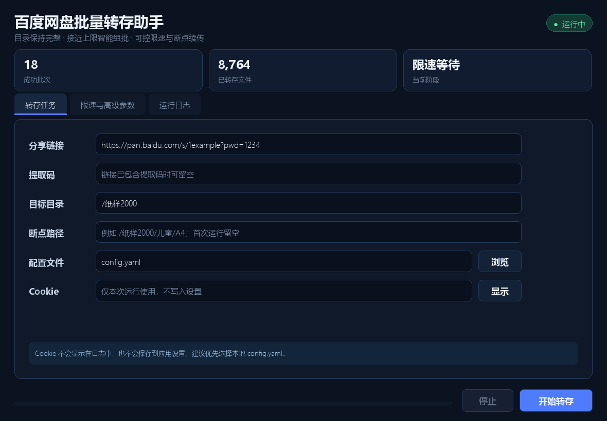

# Baidu Free Transfer Desktop

一个面向 Windows 的百度网盘批量转存工具。它在原项目命令行能力之上增加了 Pygame 桌面界面、断点续传、递归组批、可调限速策略，以及可直接下载使用的独立 EXE。

> 本项目仅用于转存你有权访问和保存的内容。请遵守百度网盘服务条款及内容版权要求。



## 主要能力

- 图形化填写分享链接、提取码、目标目录、Cookie/配置文件。
- 深度优先递归扫描，凑到接近设定文件数后立即发起转存，不必预先扫描完整棵目录树。
- 单个文件夹不会为了填满一批而被拆开；超过账号限制时才会向下一层递归处理。
- 自动跳过目标网盘中已确认完成的目录，并支持从明确的异常目录继续。
- 每批文件数、请求间隔、休息触发次数、休息时长、重试次数和网络超时均可在界面调整。
- 实时日志、成功批次和已处理文件数统计；Cookie 不写入日志，也不保存到应用设置。
- 提供 PyInstaller 一键打包脚本和 GitHub Actions Release 工作流。

## v0.2.1 更新

- 修复嵌套目录组批时只统计文件、未统计目录节点，导致百度接口二次判定超限的问题。
- 当前批放不下某个完整文件夹时，该文件夹会作为下一批起点，并继续吸收后续文件夹直至接近上限。
- 接口仍意外拒绝批次时，仅提交可接受的前段，将未提交尾部保留并与后续目录重新组批，减少过小批次。
- 实时日志同时显示递归文件数和百度接口实际使用的展开条目数。

## 直接使用 EXE

1. 从仓库的 **Releases** 页面下载 `BaiduFreeTransfer.exe`。
2. 打开程序，将百度网盘分享链接粘贴到“分享链接”。链接带 `pwd` 时可不再填写提取码。
3. 在“目标目录”填写网盘内保存位置，例如 `/纸样2000`。
4. 二选一提供登录信息：选择本机的 `config.yaml`，或临时粘贴 Cookie。Cookie 只在本次运行内存中使用。
5. 首次执行让“断点路径”保持为空。只有在明确知道上次异常位置时，才填写完整的目标网盘路径。
6. 在“限速与高级参数”确认策略后，点击“开始转存”。
7. 日志显示“全部完成”后，到百度网盘中核对目标目录。

### Cookie 配置文件

程序默认兼容如下 YAML：

```yaml
cookie: "BDUSS=...; STOKEN=...;"
```

`config.yaml` 已加入 `.gitignore`，不要将 Cookie 提交到仓库、Issue 或截图中。Cookie 失效时请在浏览器重新登录后更新本机配置。

## 参数说明

| 参数 | 默认值 | 可调范围 | 说明 |
|---|---:|---:|---|
| 每批展开条目上限 | 500 | 1–500 | 文件和目录节点合计接近该数量时组批，且不为了凑批拆分文件夹 |
| 请求间隔 | 30–60 秒 | 0–3600 秒 | 每次转存请求前随机等待 |
| 休息触发请求数 | 10–20 次 | 1–1000 次 | 达到随机次数后进入长休息 |
| 休息时长 | 60–300 秒 | 0–86400 秒 | 每轮随机休息时长 |
| 错误重试 | 10 次 | 0–100 次 | 处理临时网络和接口错误 |
| HTTP 总超时 | 60 秒 | 1–3600 秒 | 单个请求总时限 |
| 连接超时 | 15 秒 | 1–3600 秒 | 不得超过总超时 |
| 读取超时 | 45 秒 | 1–3600 秒 | 不得超过总超时 |

较短的间隔可能增加账号安全校验概率。程序提供可调参数，不保证任何设置可以避免服务端限制。

## 断点续传行为

- 不填写断点路径：从目标目录开始核对，已存在且确认完成的目录会被跳过。
- 填写断点路径：程序在其祖先层级直接绕过较早的同级目录，从指定位置继续，再处理后续同级目录。
- 断点路径必须位于目标目录之下，例如目标目录 `/纸样2000`，断点可为 `/纸样2000/儿童/A4`。
- 若某一批发生可重试的临时错误，程序会根据设置自动等待并重试。

## 从源码运行

要求 Python 3.10 或更高版本。

```powershell
python -m venv .venv
.\.venv\Scripts\python.exe -m pip install -r requirements.txt
.\.venv\Scripts\python.exe -m baidutransfer.gui
```

命令行仍然可用：

```powershell
.\.venv\Scripts\python.exe -m baidutransfer `
  "https://pan.baidu.com/s/1xxxx?pwd=1234" `
  --config config.yaml `
  --destination /纸样2000 `
  --max-files 500 `
  --request-interval-min 30 `
  --request-interval-max 60 `
  --rest-after-min 10 `
  --rest-after-max 20 `
  --rest-duration-min 60 `
  --rest-duration-max 300
```

需要从异常位置继续时增加：

```powershell
--resume-path /纸样2000/儿童/A4
```

## 打包 Windows EXE

一键脚本会创建隔离的构建环境、安装依赖、生成图标、调用 PyInstaller，并输出 SHA-256 校验文件：

```powershell
.\scripts\build.ps1 -PythonExe "C:\path\to\python.exe"
```

输出文件：

```text
release/BaiduFreeTransfer.exe
release/SHA256SUMS.txt
```

二次打包且依赖环境未变化时可执行：

```powershell
.\scripts\build.ps1 -SkipEnvironmentSetup
```

## 测试与界面截图

```powershell
python -m unittest discover -s tests -v
python scripts/capture_ui.py docs/images/main-window.png
```

截图脚本使用 Pygame 离屏渲染，只填充演示数据，不会读取 Cookie，也不会发起任何网盘请求。

## Release 自动化

推送形如 `v0.2.1` 的标签后，`.github/workflows/release.yml` 会在 Windows Runner 上构建独立 EXE，创建 GitHub Release，并附带 EXE 与 `SHA256SUMS.txt`。也可以手动触发工作流，仅生成 Actions 构建产物。

## 项目结构

```text
baidutransfer/
  gui.py          Pygame 桌面界面与后台工作线程
  runner.py       GUI/CLI 共用的任务入口与参数校验
  settings.py     可调限速、批量、重试和超时参数
  transfer.py     深度优先扫描、组批和断点续传
  apis.py         百度网盘请求与节流重试
scripts/
  build.ps1       Windows 独立 EXE 构建
  capture_ui.py   README 实际界面截图
tests/            离线单元测试
```

## 致谢与许可证

本项目基于 [drunkdream/baidu-free-transfer](https://github.com/drunkdream/baidu-free-transfer) 继续开发，保留 MIT License。桌面界面使用 Pygame Community Edition。
